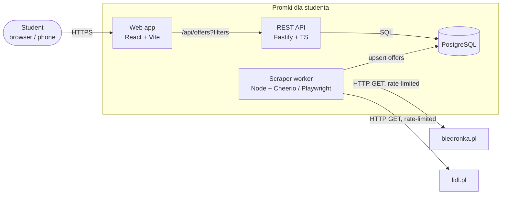
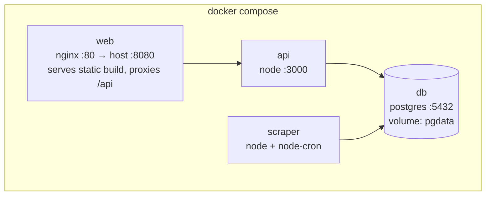
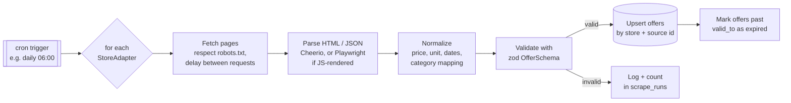
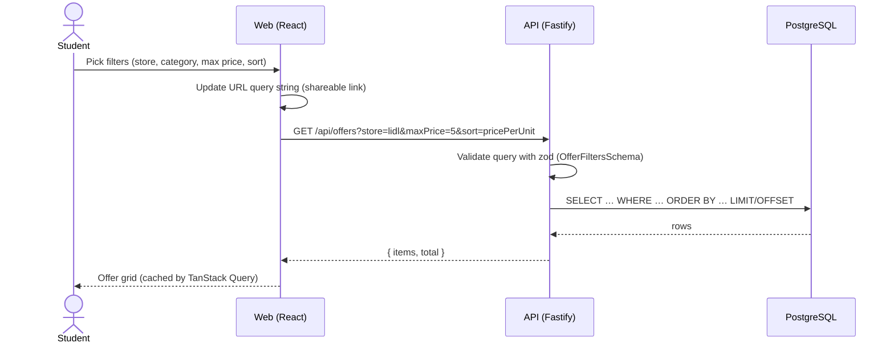
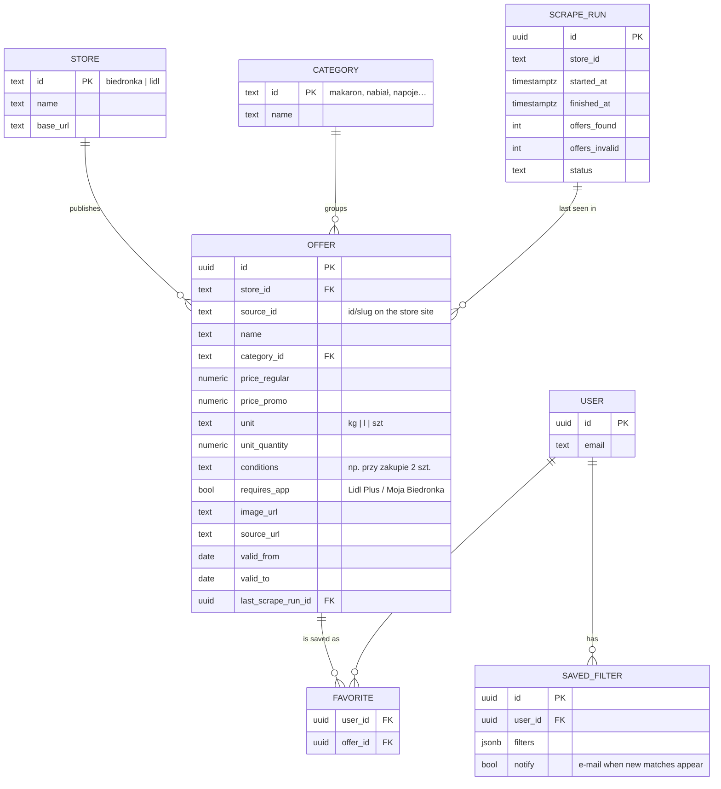

# Architecture

## 1. System context

Key idea: **scraping and serving are decoupled.** The scraper runs on a schedule
(promotions change roughly weekly) and writes normalized data to the database.
The API only reads from the database, so users never wait on — or trigger — a
request to Biedronka/Lidl, and a broken scraper doesn't take the site down.

## 2. Containers (docker compose)

## 3. Scraping pipeline

Each store is an **adapter** implementing the same interface
(`apps/scraper/src/adapters/types.ts`). Adding a new store (Żabka, Aldi, Kaufland…)
means adding one file, not changing the pipeline.

## 4. Request flow — filtering offers

## 5. Data model (draft)

`USER`, `FAVORITE` and `SAVED_FILTER` are for later milestones — the MVP works
without accounts (filters live in the URL).

Constraint worth having from day one: `UNIQUE (store_id, source_id, valid_from)` so
re-running the scraper is idempotent.
